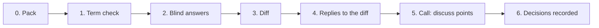

# Task packs: group work in an async mode

Members of a group often share no free slot. A task pack lets each member work alone on the same material, compares the answers by a fixed procedure, and keeps the joint call for the points the members mark for discussion. Decided by the case owner on 2 November 2026 (dz02#l=11 and dz02#l=15, gate АС2 В: the tooling lives in the engine). The commands are `smd task check | render | diff | agenda`; the procedures are `procedures/task-pack.md` and `procedures/task-diff.md`; the example is `cases/example/task/` (invented).

The pack carries the ontology and the terms of the task, not only questions. A list of questions shares words, not concepts, and then the agreement found in the answers is only apparent (G. P. Shchedrovitsky, 1964). A disagreement the diff finds marks where the group has to state what the object is: that is what the call is for.

## The cycle



| Step | Who | Output |
|---|---|---|
| 0. Pack | the builder (`task-pack`), approved by the facilitator | `pack.yaml`, then `pack.md` and `pack.html` |
| 1. Term check | each member alone, first in the pack, before the definitions are read | `term_check` of the answers file, in the member's own words |
| 2. Answers | each member alone, blind | `answers_<member>.yaml`, exported from `pack.html` or written by hand |
| 3. Diff | anyone: a script, then the model (`task-diff`) | `diff.yaml`, `diff.md`, `diff.html`; the raw answers stay attached |
| 4. Reply | each member alone | `replies_<member>.yaml`: per open point accept another member's answer, keep mine as a position, or discuss |
| 5. Call | all members | the points on `agenda.md` only |
| 6. Record | the facilitator or the model, from the decisions | a patch to the board, matrix entries, the decision log |

Step 2 is blind, for every member including the owner of the project. A member who reads the others first anchors on them, and the alpha of the diff then measures nothing. The diff is run after the last answer arrives. Anyone can run it: the pack's sha256 and the raw answers make every run checkable by the other members (gate АС3 В). The facilitator decides who presses the button.

**Re-run rule.** In a group pack anyone re-runs the diff and gets the same bytes. In a deal pack the shared part (the diff of the core, views, agenda, `check`) is re-run by anyone with the pack and the answers; the sealed part (`smd deal verdict`, the comparison of a floor and a ceiling) only by the holder program, the only one with the sealed files. Anyone can check the result against the ledger with `smd task diff --ledger`. See `deal-mode.md`.

## Files

| File | Record | Schema |
|---|---|---|
| `pack.yaml` | `task_pack` | `src/smd_engine/schemas/task_pack.schema.json` |
| `answers_<member>.yaml` | `task_answers` | `task_answers.schema.json` |
| `replies_<member>.yaml` | `task_replies` | `task_replies.schema.json` |
| `diff.yaml` | `task_diff` | no schema; written by `smd task diff`, edited by the model |
| `agenda.yaml` | `task_agenda` | no schema; written by `smd task agenda` |
| `diff.<position>.yaml` | `task_diff` with a `view` block | no schema; written by `smd deal views` (deal packs) |

They are plain YAML named by the cycle. `smd validate` does not discover them; `smd task check` does the schema and cross checks. All carry `schema_version: "0.1"`.

**Pack.** `id`, `version`, `date`, `due`, `lang` (ru or en: the language of the rendered pages), `members` (id, name), `facilitator` (a member id), `task` (`what`, `why`, `feeds` with `text` and `ids`), `ontology` (`terms` with definition and source address; `elements` with id, label, optional `tier` 1 to 6 and `kind`; `relations` with from, to, kind), `sources`, `term_check` (3 to 7 items), `items`, `diff.procedure`. An item has `id`, `section`, `question`, `kind` (`choice`, `multi`, `text`, `number`, `ids`, `steps`), `options` (id, label, context; required for `choice` and `multi`), an optional `recommendation` (`value`, `reason`; only where the item is a gate), `refs` and `required` (default true).

**Answers.** `pack` (id, version and the sha256 of the pack file), `member`, `date`, `drafted_by` (`self` or `model_edited`), optional `transcripts`, `term_check` (item id to text), `answers` (item id to `value`, `reason`, `source`, `confidence` low, medium or high, `term_note`), `added` (points the member adds, with `refs`). A value is an option id for `choice`, a list of them for `multi`, a number, a text, a list of ids, or a list of steps.

**Replies.** `diff` (the sha256 of `diff.yaml`), `member`, `date`, `replies` (point id to `choice` accept, keep or discuss, `accept_member` when accepting, `note`).

## Commands

```bash
uv run smd task check pack.yaml answers_*.yaml
uv run smd task render pack.yaml -o out/pack
uv run smd task diff pack.yaml answers_*.yaml -o out/diff
uv run smd task check pack.yaml --replies replies_*.yaml --diff out/diff/diff.yaml
uv run smd task agenda out/diff/diff.yaml replies_*.yaml --members ana,ben,cy -o out/agenda.md
```

- `check`: the pack against its schema and its own consistency (unique ids, known `refs`, relations between known elements, a recommendation that is an option, a term check of 3 to 7 items); each answers file against its schema, the pack id, version and sha256, the member, the item ids, the option ids and the kind of each value, required items without an answer, and the sha256 of each transcript; replies against their schema, the member, and with `--diff` the diff sha256, the point ids and `accept_member`. Errors give exit 1; warnings do not.
- `render`: `pack.md` and `pack.html` from a pack; `diff.md` and `diff.html` from a `diff.yaml` (so the model's edits are drawn again).
- `diff`: refuses an answers file that fails `check` (a different pack sha256 included) and two files of one member. It will not overwrite a `diff.yaml` that differs from the new one, since the model may have written into it; `--force` does.
- `agenda`: `agenda.md` beside `agenda.yaml`. `--members` lists who is expected to reply. A replies file for another diff is refused.

## The pages

`pack.html` is one offline file: the style and the script are inline and nothing is fetched. Tabs: the task, the term check, the ontology slice (terms, the relations drawn as inline SVG, elements), the items as a form, and the answer file. The drawing is made in Python: every label is wrapped into its box, boxes are sized to the text and do not overlap. Elements with tiers go in rows by tier and the arrows bend round boxes in their way; when no element has a tier and the relations run from many sources to one target each target is drawn with its sources under it, in columns, and the page scrolls down. A narrow drawing replaces the wide one on a phone. An `ids` item is a checklist of the element labels (the `refs` of the item, or every element when it has none), grouped under the element their relations lead to, with a filter box, an "only ticked" switch and a count; the exported value is the list of ids. People see labels, numbers and names; ids stay in the files and in attributes. The form saves itself in the browser (localStorage, keyed by pack id and version). The last tab has the member, the date, who drafted the answers, the transcripts and the added points, and a button that downloads `answers_<member>.yaml`, so a member never edits YAML by hand. `diff.yaml` carries a `labels` block (members by id, item numbers, options of choice and multi items, terms, elements) so that `diff.html`, `diff.md` and `agenda.md` show an item as "Item 3: the question", a member by name and an answer by its option label; a diff without the block is shown with ids. `diff.html` has the same shell: the summary, the points with a filter by class, and a reply form that downloads `replies_<member>.yaml`. The md files carry the same content with tables and Mermaid blocks (the cycle, the relations, a pie of the classes).

## What the diff decides

Per point (an item, a term-check item or an added point) `diff.yaml` holds the answers by member, `class`, `class_by` (`script` or `model`), `subtype` of a conflict, the default `route`, and who gave no answer (`silent`).

| Class | Meaning | Who sets it | Default route |
|---|---|---|---|
| agreement | the same value (multi, ids and steps are compared as sets, ignoring case and spacing) | script, for choice, multi, number, ids, steps | `accept`: listed only |
| refinement | one set holds another (multi and ids), the sets form a chain; for a range, each span lies inside the last | script | `accept_unless_objected` |
| compatible | range spans that share a stretch but are not a chain; the stretch is in `sets.common` | script | `accept_unless_objected` |
| only_one | one member raised it: an added point, or an item only one answered | script | `mark_each`: every other member marks it |
| conflict, term | one word for different content | model | `call` |
| conflict, position | the answers differ because the positions differ | model | `record_positions`: both kept; the call only if a member asks |
| conflict, fact | data could decide it | model | `check`: a check is assigned, no call |
| conflict, value | the answers differ on what matters more; range spans with no common stretch | model, or script for a range | `call` |
| conflict, step | `steps` sets that are not identical | script, until the model marks them compatible | `call` |
| compatible_steps | the steps can all be done, or one after another | model | `accept` |
| conflict, no subtype | different values, subtype not yet read | script | `call` |
| to_read | text and term-check items, not yet read | script (as a placeholder) | `call` until the model classifies it |
| unanswered | nobody answered | script | `call` |

The script never merges or averages. A member who is silent on an item is left out of that item's comparison and listed in `silent`; with only one answer the point is `only_one`.

Krippendorff's alpha (`agree.alpha_nominal`) is computed over the choice items, with the members as raters, and per section. Over fewer than five items the number is shown and marked "few units". A low alpha on the term check, which is free text, cannot be computed; the model reads it as `term` conflicts.

## What the model drafts

`procedures/task-diff.md`: classifies the `to_read` points (agreement, refinement, conflict), gives a conflict its subtype with a quoted rationale, marks compatible steps, sets `route` from the table, and writes all of it into `diff.yaml` with `class_by: model` and a `model_pass` block marking it an AI draft. It reads free text and the transcripts as raw sources; it never merges answers; it never writes a sign-off. A member can reclassify any point at step 4.

## Reply, agenda, call

An open point is one whose route waits for the members, `call` or `mark_each`. Every member except the one who raised an `only_one` point replies to each open point. `smd task agenda` puts a point on the call when:
- at least one member chose `discuss`, whatever its class (gate АС5 А), or
- it is open and a member did not reply: a missing reply counts as `discuss`, and the agenda says which member.

A point not on the call is settled, and the agenda says how: by its class (accepted, accepted with no objection, positions recorded, a check assigned), or by the replies (`replies`: everyone replied accept or keep). Each call point shows the class beside it, so a member sees when `discuss` is on something a check could settle.

## Voice

A member may record voice while answering and attach the transcript to the answers file (`transcripts`: `path` relative to the answers file, `sha256`, `note`) as a fuller raw source of the position. `pack.html` fills the sha256 when the member picks the file; nothing is uploaded. `diff.yaml` lists the transcripts per member and checks the sha256 when the file exists (`ok`, `mismatch`, `not_found`, `no_sha`). The written answer is still the position; the transcript helps the reader.

## Example

`cases/example/task/` has a pack for the bakeries case, answers from three invented members built to give agreement, refinement, only one, conflicts (a choice and steps) and text to read, a transcript, and two replies files. The answers carry the sha256 of `pack.yaml` and the replies that of the `diff.yaml` the example gives; `tests/test_task.py` says how to restamp them after a change.

## Deal mode

The whole of deal mode, with the sealed branch, the trust step for pilots and the threat model, is described in `deal-mode.md`; this section lists the fields.

For a sale or transfer, whose members are counterparties, a pack adds optional fields. Group packs are unchanged and render byte for byte as before (`tests/test_deal_golden.py`). The invented example is `cases/example/deal/`; schema stays `0.1`.

- **Positions and audience.** `positions` (seller, buyer, broker_sell, broker_buy, successor, family, adviser, verifier, stakeholder, other); `members[].position`, `members[].principal` (a broker names whom he acts for). An item or ontology term with `audience` (position ids) is in the annex of those positions; the rest is the shared core. A deal pack is stamped with the sha256 of its core (`smd task check` prints it and each annex sha256); answers carry it and `pack.annex: {position, sha256}`. `smd task render --position <id>` writes the core and that position's annex only.
- **Alpha** is computed on the shared core, leaving out items with an audience and items of `nature` value or position; `alpha.basis` says how many.
- **Fact items.** `kind: fact` with a `claim` (`text`, `asserted_by`, `source`, `level` stated or checked); answers holds, does_not_hold, cannot_say, optionally `source_ids`. Sources may carry `sha256` and `date`. A disagreement is `conflict: fact`, route `check`.
- **Reading and fit.** `nature` (term, fact, value, position) and `fit_of` (the reading item). A fit point that conflicts while its reading conflicts gets `after_reading` and the route `call`.
- **Red lines.** `kind: line` with a `line` in the shape of `docs/red-lines.md`; answers accept or reject. Any reject makes the class `line_rejected` and the route `blocking`: the point is always on the call and a reply cannot accept it.

- **Map acceptance.** A pack may pin the map the members are asked to accept: `map: {id, version, sha256}` (a board set; `version` is its `state.version`, else its cycle; `sha256` that of its file). A member's acceptance is a `task_acceptance` record (`src/smd_engine/schemas/task_acceptance.schema.json`) in three layers: `vocabulary` (accept, reject, not_read), `elements` (element id to accept, reject or not_read; an element not listed is not_read) and `check` (done, not_done, unknown; `done` needs `checked_by`). It is pinned to the board's `{id, version, sha256}`; the member writes it, the engine writes no acceptance and no sign-off. `smd task check pack.yaml --acceptance a.yaml ... [--board map.board.yaml] [--prior earlier.board.yaml]` prints each acceptance in one line and reports: unknown members and element ids (errors), a `checked_by` who is a member of the pack (warning: not independent), and a void acceptance (warning). Any edit of the board file, a comment too, changes the sha256 and voids it; a new cycle of the board (another id) is void the same way. With `--board` (the file the map names) and `--prior` (the file the acceptance was given on) the check says which elements to ask again: `smd compare`'s matcher (`compare.compare`) finds each element of the prior board in the current one, and an agreement stands; a reworded, moved, retyped or new element is asked again. The vocabulary and the check are asked again in full when the map is void.
- **Ranges.** `kind: range` with a `unit` (any pack, deal or group). The answer is `value: {min, max, unit, date?}` in the item's unit; a unit that differs from the item's, `min` above `max` or a non-finite number is an error in `smd task check`, and a diff refuses the file. The script classes two or more spans: identical (dates are ignored) is `agreement`; each inside the last is `refinement`; a common stretch without a chain is `compatible` (route `accept_unless_objected`, the stretch in `sets.common`); no common stretch is `conflict: value` (route `call`). Nothing is averaged. The page asks for from, to, the unit and an optional date.

- **Asking price.** `deal.asking_price: {value, unit, stage?}` is required in a deal pack with a seller (error otherwise): the seller's asking price, shared; `stage` is the stage of `deal.stages` at which `smd task render --stage` opens it on the pack pages (default: the stage after `nda`). The diff and the agenda show it. An item may name its `stage`. `deal.sealed_floor` (default false) switches on the sealed branch below: a `bound` item is an error without it, and with it every verdict run needs the seller's consent naming the buyer. The buyer gives no number; an optional shared choice item at the last stage asks whether he is ready to discuss the price. See `deal-mode.md`.
- **Sealed bounds.** `kind: bound` with `bound: {topic, side, unit, stage?}`: a one-sided limit on a number, usually the price, that its party keeps to itself. `side: floor` is the seller's lowest acceptable value, committed at day 0, before stage 1; `side: ceiling` is the buyer's highest, optional, committed only at the last stage (`deal.stages`), after he has studied the business, so the pack never asks the buyer for a price earlier (a ceiling in an earlier stage, or none named, is an error; a floor names no stage). The item has an `audience` that holds exactly one member of the seller's kind (floor) or the buyer's (ceiling); several buyers mean one pack per buyer. The page shows no input box. The party runs `smd deal seal pack.yaml <item> -o <folder outside every repo>`, which asks for the number unseen (or takes `--value`), writes `sealed_<member>_<item>.yaml` (`task_sealed`: the number and a random 64-hex salt; mode 0600; never overwritten) and prints the commitment, `sha256("smd-seal-v1\n" + canonical JSON of deal, pack id, core sha, item, member, side, unit, value, salt)`. The commitment goes into the answers file as the item's value and nothing else may go there (reason, source and the like are errors, and so is a number); the diff point (class `sealed`, route `price_meeting`) lists `committed_by` and `silent` and holds no answers. `smd task check` warns about a `sealed_*.yaml` beside the answers that sits in a git work tree and is not ignored. A sealed file is refused as an input of `task diff`, `check`, `render` and `agenda`. The verdict flag on the point is `not_tested` until the holder has run the comparison (next two items).
- **Price is for the meeting.** The verdict is a flag, `met`, `not_met` or `not_tested`, never a stop: its route is `price_meeting`, where the parties bargain in person holding a close shared picture of the business from the pack. Agreement on everything except price is a normal result. Pages say «цена: условия сошлись / не сошлись / не проверено — торг на личной встрече» (English: "price: terms met / not met / not tested - bargain at the in-person meeting"). A reply to a sealed point is keep or discuss, never accept.
- **Holder.** `holder: {kind: program|organisation|person, name, operator?, program, method: local-v1}` and `deal: {id, stages?, model_consent?, asking_price?, sealed_floor?}`. The facilitator sends the pack; the holder is a program, and in pilots an organisation runs it. A bound item without a holder or `deal.id` is an error; so is a broker as `operator` (a broker never runs it); an operator who is a seller or buyer is a warning.
- **Model consent.** `deal.model_consent` (default false). A pack with a `deal` block gives its diff `model_pass_allowed`, and the pages say so; when it is false the model pass of `procedures/task-diff.md` stops there and no transcript is read. A diff never takes a `task_sealed` file as input.

- **Verdict and ledger.** `smd deal verdict pack.yaml <topic> --answers a.yaml b.yaml --floor sealed_<seller>_<item>.yaml [--ceiling sealed_<buyer>_<item>.yaml] --ledger verdicts.yaml` is the holder's command. It checks the cap first, then opens each sealed file, accepts it only when its deal, pack core sha, member, item, side and unit are the pack's and its recomputed commitment equals the one in the member's answers, and compares the two numbers with the comparator named by `holder.method` (`local-v1`: floor at most ceiling; `src/smd_engine/deal/overlap.py` defines the `Comparator` protocol, so a two-party protocol can replace it without changing the files, the commitments, the ledger or the verdict). The result is one entry in the ledger (`task_verdicts`; entries are hash-chained by `prev_sha256` and each has its own `sha256`): `met`, `not_met`, or `not_tested` with a `reason` (`no_floor`, `no_ceiling`, `bad_commitment`, `unit_mismatch`, `consent_missing`, `commitment_changed`, `cap_reached`). The ledger and everything printed hold no number, no salt and no gap. A buyer who gives no ceiling gets `not_tested` (`no_ceiling`) and the price goes to the meeting. `smd task diff ... --ledger verdicts.yaml` verifies the chain and writes each bound point's `verdict` (the latest run made, else `not_tested`) and `ledger_head`; a ledger cut short later no longer matches the head of an earlier diff, and `task diff` refuses to overwrite that diff.yaml. A commitment in the answers that differs from the one the latest counted run used makes the points `not_tested` with `changed_since_run`. The first run of a ledger takes `--new`; without it the file must exist. A diff made before the verdict is replaced by the one with `--ledger` (they differ in the sealed points' verdict fields only); other differences still need `--force`.
- **Run cap.** One run per seller-buyer pair, topic and deal. Every run needs a `consent` entry by the seller naming the buyer (the consent file has `buyer`; the first consent of a deal takes `--new`); a second run needs one from each of the two parties too (`smd deal consent pack.yaml <topic> --member <id> --evidence <file> --ledger verdicts.yaml`; the file is the party's `task_consent` record for this deal, topic, run and member naming the floor and ceiling commitments now in the answers; the entry keeps its sha256 and the commitments, and a run with other commitments is `commitment_changed`; the holder's own word is not enough, the engine checks the file but has no signature, and a broker cannot consent); two runs at most, and a third is `cap_reached`. A run that returns `not_tested` gives nothing away and does not use a run. Pilots: the parties send their sealed files to the organisation age-encrypted, outside the engine; it decrypts them only for the run, on a RAM disk. This is a trust step in the holder and its machine, which `local-v1` does not remove.

- **Pairs.** `pairs: [{id, members: [a, b], label?}]` names the member pairs compared on their own (a seller and a buyer, a broker and a buyer); each member is one of the pack's, the two differ, and a pair appears once. The diff then has `by_pair`: for each pair, the class and route of each point both members were asked (an item with an `audience` only if both are in it; added points are left out), worked out from their two answers only, with a summary. The classes of the whole diff are unchanged. The agenda has `call_by_pair`: for each pair, the ids of the points on the call that a pair member put there (discuss, no reply, or a rejected red line). A point on the call that no pair put there stays in `call` only.
- **Views.** `smd deal views pack.yaml diff.yaml -o out/views [--position id]` writes `diff.<position>.yaml`, `.md` and `.html` for each position: a `task_diff` with a `view` block (`position`, `diff`: the sha256 of the whole diff.yaml). The whole diff is for whoever runs it; a view is what a position is sent. It leaves out the points not for the position (`audience`); a fact dispute (class `conflict`) over a claim of the buyer's side, unless the viewer is on that side; and, on a value point (`nature: value`, a `value` conflict, or a range with no nature), the class, route, `sets`, `silent` and the answers of the other side, which shows only the class `open` or `settled`. A side is "sell" (seller, sell-side broker), "buy" (buyer, buy-side broker) or the position alone; a broker is on the side of the position his principal holds, so he gets his principal's view of the other side's answers, within his own audience. The summary, `by_pair`, labels and transcripts are cut the same way. A view is rendered and replied to like a diff (`smd task render`); an agenda is built from the whole diff only, and for a deal diff it shows no answers or notes of a value point or of a point for some positions (`answers_withheld`). `smd task check --replies r.yaml --diff diff.<position>.yaml` checks `diff` in the reply against the view's `view.diff`; a reply may carry `view`, the sha256 of the view file, which the view's page writes into the reply it exports, and the check refuses another view's sha256.

Procedures `task-pack` and `task-diff` are at 0.2.0 for these fields.
