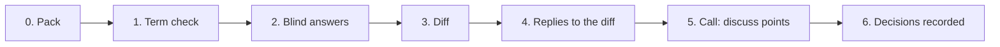

# Task packs: group work in an async mode

Members of a group often share no free slot. A task pack lets each member work alone on the same material, compares the answers by a fixed procedure, and keeps the joint call for the points the members mark for discussion. Decided by the case owner on 2 November 2026 (dz02#l=11 and dz02#l=15, gate АС2 В: the tooling lives in the engine). The commands are `smd task check | render | diff | agenda`; the procedures are `procedures/task-pack.md` and `procedures/task-diff.md`; the example is `cases/example/task/` (invented).

The pack carries the ontology and the terms of the task, not only questions. A list of questions shares words, not concepts, and then the agreement found in the answers is only apparent (G. P. Shchedrovitsky, 1964). A disagreement the diff finds marks where the group has to state what the object is: that is what the call is for.

## The cycle



| Step | Who | Output |
|---|---|---|
| 0. Pack | the builder (`task-pack`), approved by the facilitator | `pack.yaml`, then `pack.md` and `pack.html` |
| 1. Term check | each member alone, first in the pack, before the definitions are read | `term_check` of the answers file, in the member's own words |
| 2. Answers | each member alone, blind | `answers_<member>.yaml`, exported from `pack.html` or written by hand |
| 3. Diff | anyone: a script, then the model (`task-diff`) | `diff.yaml`, `diff.md`, `diff.html`; the raw answers stay attached |
| 4. Reply | each member alone | `replies_<member>.yaml`: per open point accept another member's answer, keep mine as a position, or discuss |
| 5. Call | all members | the points on `agenda.md` only |
| 6. Record | the facilitator or the model, from the decisions | a patch to the board, matrix entries, the decision log |

Step 2 is blind, for every member including the owner of the project. A member who reads the others first anchors on them, and the alpha of the diff then measures nothing. The diff is run after the last answer arrives. Anyone can run it: the pack's sha256 and the raw answers make every run checkable by the other members (gate АС3 В). The facilitator decides who presses the button.

## Files

| File | Record | Schema |
|---|---|---|
| `pack.yaml` | `task_pack` | `src/smd_engine/schemas/task_pack.schema.json` |
| `answers_<member>.yaml` | `task_answers` | `task_answers.schema.json` |
| `replies_<member>.yaml` | `task_replies` | `task_replies.schema.json` |
| `diff.yaml` | `task_diff` | no schema; written by `smd task diff`, edited by the model |
| `agenda.yaml` | `task_agenda` | no schema; written by `smd task agenda` |

They are plain YAML named by the cycle. `smd validate` does not discover them; `smd task check` does the schema and cross checks. All carry `schema_version: "0.1"`.

**Pack.** `id`, `version`, `date`, `due`, `lang` (ru or en: the language of the rendered pages), `members` (id, name), `facilitator` (a member id), `task` (`what`, `why`, `feeds` with `text` and `ids`), `ontology` (`terms` with definition and source address; `elements` with id, label, optional `tier` 1 to 6 and `kind`; `relations` with from, to, kind), `sources`, `term_check` (3 to 7 items), `items`, `diff.procedure`. An item has `id`, `section`, `question`, `kind` (`choice`, `multi`, `text`, `number`, `ids`, `steps`), `options` (id, label, context; required for `choice` and `multi`), an optional `recommendation` (`value`, `reason`; only where the item is a gate), `refs` and `required` (default true).

**Answers.** `pack` (id, version and the sha256 of the pack file), `member`, `date`, `drafted_by` (`self` or `model_edited`), optional `transcripts`, `term_check` (item id to text), `answers` (item id to `value`, `reason`, `source`, `confidence` low, medium or high, `term_note`), `added` (points the member adds, with `refs`). A value is an option id for `choice`, a list of them for `multi`, a number, a text, a list of ids, or a list of steps.

**Replies.** `diff` (the sha256 of `diff.yaml`), `member`, `date`, `replies` (point id to `choice` accept, keep or discuss, `accept_member` when accepting, `note`).

## Commands

```bash
uv run smd task check pack.yaml answers_*.yaml
uv run smd task render pack.yaml -o out/pack
uv run smd task diff pack.yaml answers_*.yaml -o out/diff
uv run smd task check pack.yaml --replies replies_*.yaml --diff out/diff/diff.yaml
uv run smd task agenda out/diff/diff.yaml replies_*.yaml --members ana,ben,cy -o out/agenda.md
```

- `check`: the pack against its schema and its own consistency (unique ids, known `refs`, relations between known elements, a recommendation that is an option, a term check of 3 to 7 items); each answers file against its schema, the pack id, version and sha256, the member, the item ids, the option ids and the kind of each value, required items without an answer, and the sha256 of each transcript; replies against their schema, the member, and with `--diff` the diff sha256, the point ids and `accept_member`. Errors give exit 1; warnings do not.
- `render`: `pack.md` and `pack.html` from a pack; `diff.md` and `diff.html` from a `diff.yaml` (so the model's edits are drawn again).
- `diff`: refuses an answers file that fails `check` (a different pack sha256 included) and two files of one member. It will not overwrite a `diff.yaml` that differs from the new one, since the model may have written into it; `--force` does.
- `agenda`: `agenda.md` beside `agenda.yaml`. `--members` lists who is expected to reply. A replies file for another diff is refused.

## The pages

`pack.html` is one offline file: the style and the script are inline and nothing is fetched. Tabs: the task, the term check, the ontology slice (terms, the relations drawn as inline SVG, elements), the items as a form, and the answer file. The drawing is made in Python: every label is wrapped into its box, boxes are sized to the text and do not overlap. Elements with tiers go in rows by tier and the arrows bend round boxes in their way; when no element has a tier and the relations run from many sources to one target each target is drawn with its sources under it, in columns, and the page scrolls down. A narrow drawing replaces the wide one on a phone. An `ids` item is a checklist of the element labels (the `refs` of the item, or every element when it has none), grouped under the element their relations lead to, with a filter box, an "only ticked" switch and a count; the exported value is the list of ids. People see labels, numbers and names; ids stay in the files and in attributes. The form saves itself in the browser (localStorage, keyed by pack id and version). The last tab has the member, the date, who drafted the answers, the transcripts and the added points, and a button that downloads `answers_<member>.yaml`, so a member never edits YAML by hand. `diff.yaml` carries a `labels` block (members by id, item numbers, options of choice and multi items, terms, elements) so that `diff.html`, `diff.md` and `agenda.md` show an item as "Item 3: the question", a member by name and an answer by its option label; a diff without the block is shown with ids. `diff.html` has the same shell: the summary, the points with a filter by class, and a reply form that downloads `replies_<member>.yaml`. The md files carry the same content with tables and Mermaid blocks (the cycle, the relations, a pie of the classes).

## What the diff decides

Per point (an item, a term-check item or an added point) `diff.yaml` holds the answers by member, `class`, `class_by` (`script` or `model`), `subtype` of a conflict, the default `route`, and who gave no answer (`silent`).

| Class | Meaning | Who sets it | Default route |
|---|---|---|---|
| agreement | the same value (multi, ids and steps are compared as sets, ignoring case and spacing) | script, for choice, multi, number, ids, steps | `accept`: listed only |
| refinement | one set holds another (multi and ids), the sets form a chain | script | `accept_unless_objected` |
| only_one | one member raised it: an added point, or an item only one answered | script | `mark_each`: every other member marks it |
| conflict, term | one word for different content | model | `call` |
| conflict, position | the answers differ because the positions differ | model | `record_positions`: both kept; the call only if a member asks |
| conflict, fact | data could decide it | model | `check`: a check is assigned, no call |
| conflict, value | the answers differ on what matters more | model | `call` |
| conflict, step | `steps` sets that are not identical | script, until the model marks them compatible | `call` |
| compatible_steps | the steps can all be done, or one after another | model | `accept` |
| conflict, no subtype | different values, subtype not yet read | script | `call` |
| to_read | text and term-check items, not yet read | script (as a placeholder) | `call` until the model classifies it |
| unanswered | nobody answered | script | `call` |

The script never merges or averages. A member who is silent on an item is left out of that item's comparison and listed in `silent`; with only one answer the point is `only_one`.

Krippendorff's alpha (`agree.alpha_nominal`) is computed over the choice items, with the members as raters, and per section. Over fewer than five items the number is shown and marked "few units". A low alpha on the term check, which is free text, cannot be computed; the model reads it as `term` conflicts.

## What the model drafts

`procedures/task-diff.md`: classifies the `to_read` points (agreement, refinement, conflict), gives a conflict its subtype with a quoted rationale, marks compatible steps, sets `route` from the table, and writes all of it into `diff.yaml` with `class_by: model` and a `model_pass` block marking it an AI draft. It reads free text and the transcripts as raw sources; it never merges answers; it never writes a sign-off. A member can reclassify any point at step 4.

## Reply, agenda, call

An open point is one whose route waits for the members, `call` or `mark_each`. Every member except the one who raised an `only_one` point replies to each open point. `smd task agenda` puts a point on the call when:
- at least one member chose `discuss`, whatever its class (gate АС5 А), or
- it is open and a member did not reply: a missing reply counts as `discuss`, and the agenda says which member.

A point not on the call is settled, and the agenda says how: by its class (accepted, accepted with no objection, positions recorded, a check assigned), or by the replies (`replies`: everyone replied accept or keep). Each call point shows the class beside it, so a member sees when `discuss` is on something a check could settle.

## Voice

A member may record voice while answering and attach the transcript to the answers file (`transcripts`: `path` relative to the answers file, `sha256`, `note`) as a fuller raw source of the position. `pack.html` fills the sha256 when the member picks the file; nothing is uploaded. `diff.yaml` lists the transcripts per member and checks the sha256 when the file exists (`ok`, `mismatch`, `not_found`, `no_sha`). The written answer is still the position; the transcript helps the reader.

## Example

`cases/example/task/` has a pack for the bakeries case, answers from three invented members built to give agreement, refinement, only one, conflicts (a choice and steps) and text to read, a transcript, and two replies files. The answers carry the sha256 of `pack.yaml` and the replies that of the `diff.yaml` the example gives; `tests/test_task.py` says how to restamp them after a change.
